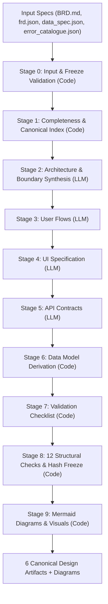

# Requirements to Design Translator Agent (`design-agent`)

> **Deterministic requirements-to-design translation with full traceability guarantees.**

Four structured specification documents in $\longrightarrow$ Six verified design artifacts out.

Every output artifact preserves exact source IDs (`BR-###`, `F#`, `NF#`, `ERR-###`), enabling end-to-end tracing from a high-level business rule down to a concrete screen, an API endpoint, a database field, and an error code.

---

## 🎯 What Problem Does This Solve?

Traditional AI code/architecture generators suffer from hallucinations, invented entities, and silent truncation. 

**`design-agent` is built with hard boundary enforcement:**
- **Code Decides, LLM Synthesizes:** Rules and cross-references are strictly validated in Python code, never left to prompt faith.
- **Fail Closed (Zero Invention):** If a field, entity, error code, or relationship isn't declared in the input specification, the pipeline stops with an exact `STOP:` reason (exit code `2`).
- **Golden Thread Guarantee:** Every single functional (`F#`) and non-functional (`NF#`) requirement must be mapped to at least one user flow, UI screen, or API endpoint.
- **Tamper-Evident Promotion:** Output files are fingerprinted with SHA-256 hashes during validation. Promotion detects and blocks any out-of-band modifications made to design files after validation.

---

## 🏗️ The 10-Stage Pipeline



| Stage | Output File | Type | Description |
|:---:|:---|:---:|:---|
| **0** | `baseline.json` verification | Code | Presence check, baseline freeze check, strict JSON parsing |
| **1** | `canonical_index.json` | Code | ID canonicalization, BRD section check, pre-LLM contradictory check |
| **2** | `architecture.md` | LLM | System boundary, module ownership of entities, screens & APIs |
| **3** | `user_flows.json` | LLM | Actor $\to$ Action $\to$ Screen $\to$ Result flows with `satisfies` |
| **4** | `ui_spec.json` | LLM | Screens, layout fields, error ID bindings, and module alignment |
| **5** | `api_contracts.json` | LLM | Endpoints, HTTP methods, payload schemas, and error responses |
| **6** | `data_model.json` | Code | Mechanical derivation of DB types, PKs, and FK relationships |
| **7** | `validation_checklist.json` | Code | Cross-reference of requirements, fields, and error codes |
| **8** | `stage8_report.json` | Code | 12 automated checks (Golden Thread, FK integrity, scope boundary) |
| **9** | `diagrams/*.html` | Code | Interactive visual diagrams rendered from Mermaid specs |

---

## 📦 Input & Output Contract

### The 4 Required Inputs
All 4 documents must be present in the input directory:
1. **`BRD.md`**: Business Requirements Document with numbered sections (including Section 5 Scope and Section 6 Business Rules).
2. **`frd.json`**: Functional Requirements Document listing all `F#` and `NF#` requirements.
3. **`data_spec.json`**: Entities, fields, types, foreign keys, fixtures, and state transitions.
4. **`error_catalogue.json`**: Authoritative catalogue of `ERR-###` codes, user messages, and HTTP status codes.

### The 6 Output Design Artifacts
1. **`architecture.md`**: System boundary, modules, and component responsibilities.
2. **`user_flows.json`**: User journeys mapped directly to requirements.
3. **`ui_spec.json`**: Screen-by-screen specifications with exact field types and errors.
4. **`api_contracts.json`**: Complete REST API specifications.
5. **`data_model.json`**: Database schemas, columns, constraints, and relational mappings.
6. **`validation_checklist.json`**: Matrix of verification checks linking UI fields to error triggers.

---

## 🚀 Quickstart

### 1. Installation
Clone the repository and install with optional extras:

```bash
git clone https://github.com/your-username/Requirements-to-design-translator-agent.git
cd Requirements-to-design-translator-agent

# Install dependencies (anthropic + web ui + dev tools)
pip install -e ".[anthropic,ui,dev]"
```

### 2. Run via the Web UI (Easiest)
Start the built-in single-page web server:

```bash
design-agent ui --port 8000
```
Open **`http://localhost:8000`** in your browser:
- Drag and drop your 4 specification files.
- (Optional) Click **✨ Load Happy-Path Sample Files** to test immediately in Demo/Replay mode without an API key.
- Provide your Anthropic API Key and click **🚀 Run Design Agent**.
- Inspect all 6 artifacts interactively across tabs or download them as `design_package.zip`.

---

### 3. Run via CLI

#### A. Live Pipeline Run (Anthropic API)
```bash
export ANTHROPIC_API_KEY="sk-ant-..."

# 1. Freeze inputs (produces baseline.json with SHA-256 digests)
design-agent freeze ./inputs --version v1 --approved-by "Alice"

# 2. Verify inputs (Stages 0, 1 & early Stage 8 checks without spending LLM tokens)
design-agent verify ./inputs

# 3. Execute full pipeline (Stages 0-9)
design-agent run ./inputs --out ./out --model claude-3-7-sonnet-20250219

# 4. Promote verified package to approved release
design-agent promote ./out/raw/run-2026-11-08-01 --out ./out --version v1.0 --approved-by "Alice"
```

#### B. Offline Demo / Replay Run (No API key needed)
Run the pipeline deterministically against recorded fixtures:
```bash
design-agent run examples/happy-path/input --out ./out \
  --llm replay --replay-dir examples/happy-path/replay
```

#### C. Record a Live Run as a Replay Fixture
Turn any real API run into an offline regression test fixture:
```bash
design-agent run ./inputs --out ./out --llm record --record-dir ./fixtures/my-run
```

---

## 🛡️ Reliability & Security Features

- **Prompt Caching:** Pinned ephemeral breakpoints for common instructions and the canonical index save token costs and speed up repeat stages.
- **`max_tokens` Guard:** Detects truncated tool responses from LLM providers and fails loudly rather than emitting corrupted artifacts.
- **Module Sharding for Large Requirements:** When an FRD exceeds context thresholds, stages automatically partition workloads by architecture module and merge results with cross-module validation.
- **Scope Boundary Guard (BRD 5.2):** Root-stemmed token overlap matching catches out-of-scope creep in titles and statements before any code or design is synthesized.
- **Reproducible Build Timestamps:** Supports the `SOURCE_DATE_EPOCH` standard for deterministic baseline generation in CI pipelines.

---

## 🧪 Testing & Validation

The test suite runs completely offline with 0 external network dependencies:

```bash
pytest
```

The test matrix includes 14 mutation negative cases verifying that defective inputs fail at the expected stage before LLM calls:
- Missing files (`TC-MISS-01..04` $\to$ Stage 0)
- Malformed syntax (`TC-MALF-01..02` $\to$ Stage 0)
- Incomplete schemas (`TC-INC-01..04` $\to$ Stage 1)
- Undefined error references (`TC-CONT-01` $\to$ Stage 8 check 4)
- Dangling foreign keys (`TC-CONT-02` $\to$ Stage 8 check 10)
- Out-of-scope requirements (`TC-CONT-03` $\to$ Stage 8 check 11)
- Happy-path end-to-end regression test (`TC-HAPPY-01`)

---

## ☁️ Deployment Guide

### Deploying the Web UI
Because the agent runs 4 sequential LLM stages (typically taking 25–60 seconds total), **avoid serverless platforms with 10-second limits** (such as Vercel Free). 

Deploy to persistent or container platforms:

#### Render / Railway / Fly.io / Docker
- **Build command:** `pip install -e ".[anthropic,ui]"`
- **Start command:** `uvicorn design_agent.server:app --host 0.0.0.0 --port $PORT`

#### Dockerfile Example:
```dockerfile
FROM python:3.12-slim
WORKDIR /app
COPY . /app
RUN pip install --no-cache-dir -e ".[anthropic,ui]"
EXPOSE 8000
CMD ["uvicorn", "design_agent.server:app", "--host", "0.0.0.0", "--port", "8000"]
```

---

## 📄 License

Distributed under the Apache-2.0 License. See [LICENSE](LICENSE) for details.
